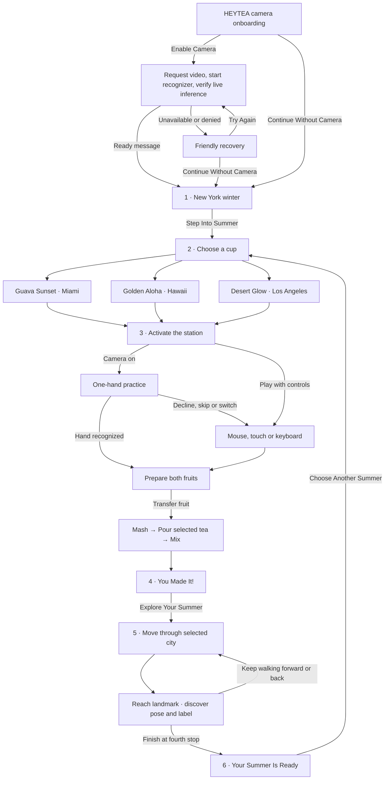
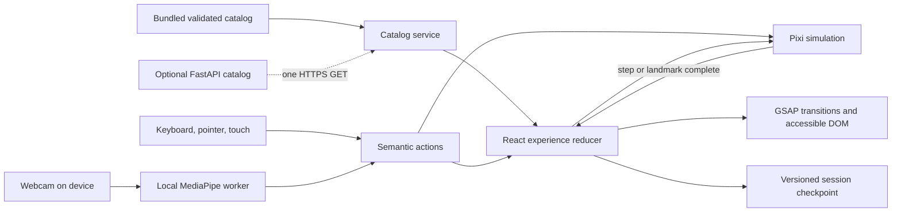

# HEYTEA · Summer Is Not a Season
## Make Your Summer — experience and engineering plan

**Approved for implementation · November 10, 2026.** Entry camera onboarding is required before the Summer Globe. Timings, gesture thresholds, production sizes and performance budgets below are proposed targets for testing.

## 1. Project overview

A visitor steps out of a New York winter, enters a transparent tropical globe, and makes a drink with their hands. That drink opens an illustrated destination. The visitor travels with the white HEYTEA mascot, carrying the cup they just made. The emotional progression is cold → curiosity → discovery → participation → surprise → exploration → summer.

Design around one promise: **“You don't have to wait for summer. You can create it with HEYTEA.”** The web experience stands on its own for people who cannot visit the installation. It requires neither a physical order nor a scan. The final screen reconnects the trip to the Summer Globe without inventing event logistics.

**Recommendation.** Use React for the visitor-facing interface, GSAP for transitions, PixiJS for the drink station and city, and MediaPipe Gesture Recognizer for real webcam input. The camera path is a planned feature with its own acceptance tests. Visitors can also complete the experience with touch, mouse or keyboard. The first release can run entirely from a frontend deployment.

## 2. Campaign and reference analysis

I reviewed all 25 pages of the supplied **561 project 2.pdf**. The brief calls it **561 project 2(1).pdf**. The supplied file has the page count, recipes and destination plates described. Page references below use its physical page numbers.

| Pages | Observed in the PDF | Consequence for this design |
|---|---|---|
| 1 | Winter escape, virtual globe, three drinks and gesture-led travel. A completed drink opens a destination. | Carry the same cup identity from selection to the last stop. Include camera control in exploration. |
| 2–3 | Cup lineup and recipes. The Hawaii recipe describes a light coconut character and bright gold liquid. | Preserve the printed sleeve art and tea color. Use a translucent gold pour for Hawaii. |
| 4 | Loose, uneven, widely spaced hand lettering on white. | Obtain approved headline lettering. Use legible sentence-case live text for instructions, including an accessible name for illustrated headlines. |
| 5–6 | The same clear dome and central arch appear against winter streets, with daylight and sunset interiors. Page 6 includes an elevation/design board and an outdoor poster. | Align the arch across the transition. Reuse the warm interior at the end. The opening can be achieved with photographic planes and masking. |
| 7–8 | The kiosk separates order, activation, play, reveal and taste. Its hand cues and step copy explain what a visitor does next. | Drink selection activates the corresponding virtual station. “Play While We Brew” belongs to the installation context. Online, “Make Your Summer” introduces the task. |
| 9–10 | The first p9 storyboard is explicitly flow-only. The lower image and p10 show the visual direction, destination cups and “Use Your Body to Play” tutorial. | Keep gesture instruction close to the ingredient. Use one pictured action at a time with a live response. |
| 11–13 | Guava goes from whole to split to wedges. The lime is halved and squeezed. The mascot mashes, pours and shakes a container in the sequence. | Use the photographic fruit stages and illustrated helper. The brief specifies circular stirring for the playable mix. |
| 14–16 | Pineapple loses its rind. Lilikoi opens, its pulp is removed, and empty shells remain. Page 16 shows the Hawaii reveal and begins LA fruit. | Give scooping a visible destination in the bowl. Use p2 as cup master when checking the reveal. |
| 16–18 | Prickly pear and orange have separate peel stages. The Hawaii and LA reveal sheets carry notes about generated defects. | Treat those two reveals as composition references. Rebuild labels and product art from approved masters. |
| 19–21 | Page 19 is a section divider. Four Miami plates follow: tower promenade, waterfront garden, beachfront boulevard and Wynwood Walls. | Keep all four. Use descriptive production labels for the first three pending confirmation of public names. |
| 22–23 | Temple, lighthouse, Waikiki and palace. The mascot sits, leans at a rail, walks with a drink, and looks up near the gate. | Set pose and occlusion anchors per plate. |
| 24–25 | Hollywood greeting, Venice skateboard, seated Griffith pose and Santa Monica Pier walk. | Reserve the skateboard animation for Venice. Retain the Ferris wheel as the final route landmark. |

**Motion reference.** I could inspect MotionSite’s public BEYOND listing and its description of kinetic motion and smooth scrolling. I could not inspect a running interactive template or verify its choreography, easing curves or implementation. The globe approach, cup match cut and foreground wipes below are proposed HEYTEA sequences. Preserve native page scrolling for reading and keep game progress tied to deliberate input. [MotionSite BEYOND](https://www.motionsite.ai/templates/beyond)

**Art direction.** Pair photographic fruit with the white outlined mascot, warm off-white instruction areas and dense illustrated landscapes. Sample Miami’s guava pink, coral and leaf green from its cup. Sample Hawaii’s gold, green and turquoise and LA’s prickly-pear pink, orange and peach from theirs. Preserve the white rounded silhouette, expression, limb thickness and sunglasses where depicted. Use approved display lettering for short campaign phrases and a readable sans such as DM Sans for controls.

## 3. Complete user journey



At any playable step a visitor can change input while keeping completed actions. A camera user can select the next action with a deliberate pinch on its visible target once camera access is active. The initial permission action always uses a native control.

## 4. Detailed scene specifications

### Entry gate · Camera onboarding

The first rendered surface is a branded overlay with the Summer Globe held behind it. Keep the globe CTA, restored checkpoints and game inputs unavailable until the visitor chooses. Use an illustrated campaign cup composition, hand-lettered accents, high-contrast type and two native buttons with visible focus. Show **“Get Ready to Make Your Summer!”** and **“Enable your camera to create your HEYTEA drink and explore summer with your hands.”** Primary **Enable Camera** and secondary **Continue Without Camera** remain reachable at 320 px and 200% zoom.

Enable Camera calls navigator.mediaDevices.getUserMedia() directly from the click handler, with audio disabled and front-facing video preferred. A single session owner acquires a stream, starts the local MediaPipe recognizer, and verifies a decoded video frame plus a successful inference. An empty hand result is valid for device readiness. Only then show **“Camera Ready! Let's Make Summer.”** briefly and enter the globe. Continue Without Camera immediately selects direct controls. While permission or initialization is pending, keep the secondary action available. Denial, missing hardware, busy camera, timeout and model failure show friendly recovery text, **Try Again** and **Continue Without Camera**. No timer or saved browser permission bypasses the visitor’s choice.

Keep permission UI, resource ownership and gesture interpretation separately testable. Coalesce duplicate enable attempts, invalidate late results on cancellation and stop abandoned tracks. Display a labeled status and enable/disable control throughout the journey. Process transient frames in memory on device, with no recording, storage or upload. Production requires HTTPS.


| Scene and purpose | Composition and required art | Input, feedback and transition guard | Implementation and phone layout |
|---|---|---|---|
| **1 · Enter the Summer Globe**. Establish place and temperature. | Winter street, distant city, warm interior, arch, glass rim and sparse foreground snow. Set the campaign headline and key message outside the bright doorway. | “Step Into Summer” by click, tap or Enter locks a single entrance. Snow drifts outward, the arch fills the frame and the warm interior resolves behind the cups. Commit selection scene at the end or on Skip. | Responsive image planes with GSAP transforms and an iris mask. Preload the selection art during the opening. Portrait uses a doorway crop and bottom CTA. Reduced motion dissolves between two stills. |
| **2 · Choose Your Summer**. Connect taste with place. | Three actual cup compositions occupy a single illustrated counter. Display destination, drink name, ingredients and a small destination vignette for the focused cup. | Hover/focus previews art. Tap or arrow selects a candidate. “Make this drink” commits exactly one recipe and enters its station. On desktop a direct cup activation can both focus and expose the confirmation. | React semantic radio group, GSAP cup lift. On phones show one large cup with all three named choices accessible below. Keep the selected name and recipe visible. |
| **3 · Make Your Summer**. Turn a recipe into a physical action. | One fruit at a time, working bowl in reach, helper pose, a short instruction and a step indicator. Replace the ingredient with a pitcher or spoon as the step changes. | Camera calibration or direct controls → prepare two fruits → transfer → mash → pour → mix. The art changes in proportion to input. Only a completed mix unlocks the reveal. | Pixi sprites, masks and hit areas under React instructions and equivalent action buttons. Portrait stacks prompt, workspace and controls. See §9 for each mechanic. |
| **4 · You Made It!**. Recognize what the visitor made. | Match the mixing cup to its full printed sleeve. Reveal a city vignette behind it. The mascot enters and takes the same cup in a smaller travel pose. | On mix completion, settle liquid and reveal the cup. “Explore Your Summer” or its camera target enters the first stop once its art or accessible still is ready. Skip settles at the CTA. | GSAP shared cup anchor between scene layers. On phones center the cup above the CTA, with the city visible through the cup silhouette. |
| **5 · Explore Your Summer**. Give the visitor control of the mascot. | One continuous path connects the four illustrated landmarks of each destination. The mascot carries the visitor’s drink through the scenery. | The heading follows the traveler in either direction. Pause to see a location-specific activity. Movement interrupts it. The route endpoint offers “Finish your summer.” | Pixi world, camera and sprites. DOM direction controls and the landmark heading stay available. Phone uses a tighter world viewport and thumb controls. Route details in §8. |
| **6 · Your Summer Is Ready.** Close the journey. | Combine the last vista, a stable mascot pose with the chosen cup, and a faint globe rim. Repeat the key message. | At route completion show the destination and drink together. “Choose Another Summer” clears the recipe and route and returns to scene 2. | React composes already-loaded art. Portrait uses a stacked keepsake composition. A still version has the same copy and action. |

## 5. Frontend architecture

Use Lovable’s generated **React + TypeScript** project at repository root. Lovable documents **TanStack Start** as its latest template and an upgrade path from older React + Vite projects. On a new project retain Start’s route shell, server rendering and hydration. If the approved workspace supplies the older Vite SPA, keep its entry and host build output accordingly. Both can mount the same client-only game. Browser APIs, session storage, Pixi and camera initialization belong after mount. Render the branded camera choice before exposing the globe CTA. [Lovable template documentation](https://docs.lovable.dev/features/upgrade-to-tanstack-start)

- **React and Tailwind** own copy, focus, scene layout, device settings, instructions and progress. One persistent experience provider wraps the six scenes. A recipe registry supplies cup, fruits, tea, palettes and route from one selection.
- **GSAP** owns finite DOM timelines for entrance, cup selection, reveal and transitions. Keep a scoped timeline per mounted scene. Skip, reduced motion and interruption all settle the same semantic destination. Native scroll remains available outside the play surface.
- **PixiJS** owns a reusable client canvas for preparation and city exploration. Its ticker updates movement, collision zones, particles, sprite frames and parallax. Exchange coarse events with React at step boundaries and progress thresholds. Only one owner writes a given transform in a frame.
- **Input adapters** convert pointer, keyboard and camera data to the same actions: aim, grab, drag, release, press, pour, stir, move, discover and continue. Only the active input source can own a drag. Switching inputs releases held actions.
- **MediaPipe Gesture Recognizer** supplies up to two hands’ landmark coordinates and built-in fist/palm categories in one inference pass. Hand Landmarker alone would require a separate pose classifier or rules for both poses. Pinch, tilt and circular trajectories use landmarks over time. A single model covers making and travel. [MediaPipe guide and sample](https://developers.google.com/edge/mediapipe/solutions/vision/gesture_recognizer?tab=Web) · [Open-source project](https://github.com/google-ai-edge/mediapipe)

## 6. Backend architecture

The prototype needs zero backend calls. Ship a versioned, validated catalog and the approved assets alongside the frontend. Add **Python 3, FastAPI and Pydantic** only if campaign staff need to release approved content independently of frontend builds. Store the small immutable catalog as a release file. PostgreSQL has no initial role. There are no accounts, orders, telemetry, movement writes or camera endpoints in scope.

| Proposed read endpoint | Contract | Consumer and reason |
|---|---|---|
| GET /api/v1/campaign | Empty request body. Optional If-None-Match header. 200 CampaignCatalog JSON with ETag, 304 for matching cached content, 503 if a valid catalog is unavailable. | Frontend catalog service, once before recipe selection. Allows one atomic update across art, drinks and routes. |
| GET /healthz | Empty request body. 200 with status “ok” when the service and loaded catalog are ready, otherwise 503 with status “unavailable”. | Hosting readiness probe only if the API is deployed. |

**Schema.** CampaignCatalog contains schemaVersion (integer), revision (string), campaignTitle, keyMessage, three recipes and three routes. Each Recipe has a stable id, cityId, displayName, two ordered FruitSteps with fruitId and approved mechanic, teaId, cupAssetId, paletteId and routeId. Each Route has a matching cityId, title and four ordered Stops. Each Stop has a stable id, public label, sceneAssetId, poseId and normalized landmark interval. Technical stage layouts, collision paths and texture variants live in the frontend’s versioned asset manifest. Pydantic verifies unique IDs, allowed mechanics, matching references, stop counts and finite intervals within bounds. The client also validates compatibility with the assets shipped for that build.

Deploy the React project through Lovable HTTPS hosting. If activated later, deploy the Python service separately to a managed HTTPS container, running FastAPI under an ASGI server with a readiness probe. Use Uvicorn locally. Keep the public API base URL in frontend deployment configuration and the exact allowed frontend origins in backend environment settings. Permit GET and conditional request headers, expose ETag if used cross-origin, and keep credentials disabled. Preview deployments can use bundled data until their exact origins are allowed. [Lovable hosting](https://docs.lovable.dev/features/hosting) · [FastAPI CORS](https://fastapi.tiangolo.com/tutorial/cors/)

## 7. Frontend and backend communication



Render immediately from bundled data. If enabled, start one abortable fetch at entry with a proposed two-second timeout. Adopt a response only after schema, revision and asset checks and before a run starts. Freeze the chosen revision for that run. A 304 reuses the matching validated catalog. A timeout, invalid payload, stale asset ID, blocked CORS or server outage leaves the bundled route playable. No interaction waits for retries. Do not send requests containing the selected city, gesture coordinates or device frames.

## 8. City exploration technical feasibility

| Approach | Visual result, movement and animation | Asset, mobile and performance implications | Lovable feasibility and cost |
|---|---|---|---|
| GSAP + layered DOM | Strong composed entrances, simple lane movement and small numbers of hit targets. Walking, occlusion ordering and continuous input need a separate simulation. | Needs clean planes and character frames. DOM transforms work for a small scene. Many independently animated pieces complicate compositing. | Straightforward in React. Lowest entry cost, more custom coordination across twelve playable stops. |
| **PixiJS interactive environment** | A sprite world gives direct control over the mascot, consistent draw order, camera bounds and progress-driven effects. | Uses the same layered art and sprite atlases as the design. Limit texture residency and canvas resolution on phones. Provide DOM controls and a still route for context loss. | Browser-only module in Lovable. Moderate engineering cost. Best fit for repeatable 2.5D movement across the twelve plates. |
| Three.js / React Three Fiber hybrid | True perspective and lighting are useful for a freely orbiting globe. A free camera would expose unseen sides of the illustrated settings. | Needs additional geometry, materials or more elaborate image planes. Higher asset preparation, GPU and device-test costs. | Feasible as a client-only canvas. High cost for this fixed-view journey. Reserve for a later scope with approved 3D assets. |

**Movement model.** Follow the rear-facing mascot through the selected city on a continuous reversible route. After both hands are held comfortably for 350 milliseconds, their separation becomes the neutral position. Holding them farther apart moves forward. Holding them closer moves backward. The same dead zone, response curve and speed cap apply in both directions. Returning to the neutral position or losing a hand stops movement. A visible Back / Paused / Forward meter displays the current input. Recenter hands establishes a fresh reference. A full landmark approach now takes eight seconds at full input. The longer route uses a stronger camera approach toward a destination-specific entrance or viewpoint; the next scene blends in only during the final 14%. Miami's first route reaches the tower doorway. Scene-specific framing and foot anchors keep the traveler on the available path. Architectural depth deformation stays modest while the coherent approach supplies most of the visual movement. Stale camera input stops within 250 milliseconds. The eight-frame walking animation is capped at 1.2 cycles per second.

All destinations remains visible above the scenery. At the endpoint, travel pauses for a 2.6-second celebration: the traveler turns toward the visitor, raises the selected city's cup, waves and makes one small happy hop. “Cheers to your summer!” appears, then the branded Where to next? menu fades in with Choose another city, Keep exploring and Finish your summer. Reduced motion shows a still raised-cup pose for 900 milliseconds. Leaving the route cancels the pending menu. The last menu option opens the keepsake. The menu supports keyboard focus and lets a one-hand pinch activate its buttons. Keeping the route open permits immediate backtracking. After 1.1 seconds at rest, the traveler shows the current landmark’s activity. Movement interrupts it.

Keep the traveler and the selected cup mounted throughout. Four painted depth meshes share one canvas and one travel clock. Near scenery moves faster than the horizon. Blend adjacent views while both are already moving, and run the same projection backward when the hands close. Reduced motion retains quieter travel cues.

| Stop | Miami · pp20–21 | Hawaii · pp22–23 | Los Angeles · pp24–25 |
|---|---|---|---|
| 1 | Tower promenade. Walk beneath the palms with the pink cup. | Byodo-In Temple. Settle onto the stone edge and raise the golden cup. | Hollywood. Stop and greet beneath the sign. Keep the orange/pink cup attached to the free hand. |
| 2 | Waterfront garden. Sit on the balustrade, cup in hand. | Kilauea Point Lighthouse. Lean at the rail facing the headland. | Venice Beach. Step onto the board for this stretch and glide along the promenade. |
| 3 | Beachfront boulevard. Walk past the beachfront buildings and lifeguard tower. | Waikiki Beach. Walk the shoreline promenade holding the drink. | Griffith Observatory. Sit on the stone wall facing the grounds. |
| 4 | Wynwood Walls. Walk into the mural district and pause by the painted wall. | Iolani Palace. Pause by the gate and look toward the palace. | Santa Monica Pier. Walk the boardwalk with the cup and stop with the wheel in view. |

Update the landmark name as the traveler passes it, without a page transition, focus change, or a separate continue button.

## 9. Beverage-making interaction design

Show tracking feedback and a short action cue for each recipe step. Mirror webcam coordinates once, accounting for crop and letterboxing, so a hand moving right moves the on-screen indicator right. Show a halo when a hand is tracked and compress it when a pinch engages. Normalize thumb–index distance by palm width. Use separate engage/release thresholds, pose confidence and a short stability dwell. Reset gesture history after lost tracking, resizing or changing stage. Calibrate on both hands and tune with measured device results.

**State contract for every row.** Ready displays the next target. Direct drags start on the artwork. Camera gestures may start anywhere in view. Progress maps the measured action to the art. Release pauses continuous work. Completion commits once, shows the finished illustration long enough for the cut animation to settle, then advances the recipe or reveals the drink automatically. The React instruction names the action and shows progress. Pixi draws fruit, cup, helper and effects. A native action button advances the same mechanic by a meaningful increment using click, tap, Enter or Space. It remains usable with one switch or one hand.

| Trigger and target | Camera action | Pointer/touch equivalent | Visible response, assets and completion |
|---|---|---|---|
| Miami 1 · whole pink guava | Make four alternating sweeps with either hand | Drag across seam | Separate two photographic halves along the drag. Four strokes animate the supplied mascot’s cutting arm through a score, halves, quarters and the final wedge pile (p11). |
| Miami 2 · key lime | Make four sideways cuts, then briefly squeeze and reopen four times, or make four down-and-up presses | Swipe to split, press and release to squeeze | The original p12 squeezing helper leans into the lime. Each complete squeeze changes the fruit and advances one of four counts. A held fist cannot repeat. |
| Hawaii 1 · pineapple | Pull down three strips, lifting between strokes | Drag the band | Use the original whole, helper-pulling and finished vignettes from p14. Each stroke moves the action drawing and advances the strip count. |
| Hawaii 2 · lilikoi | Make four cuts to split, then scoop three spoonfuls with a lift between sweeps | Swipe to open, drag pulp three times | The original p15 scooping figure and spoonful respond to each completed portion. |
| LA 1 · prickly pear | Pull down three strips, lifting between strokes | Drag strip | Use the original helper pulling the pink skin, then the finished red fruit and celebrating helper (p17). |
| LA 2 · California orange | Peel downward three times | Drag downward three times | Use the p17 orange helper and curling rind, followed by the finished fruit and celebrating helper. |
| Both fruits prepared · transfer | Sweep down three times, lifting to collect the next portion | Three separate drops into the bowl | The p12 pushing helper delivers each portion over a 650 ms fall; the bowl accumulates fruit. One sweep cannot finish the step. |
| Bowl ready · mash | Press down, lift to rearm, repeat five times | Five press/release strokes | The original helper and muddler compress the fruit; each press shows splashes and advances the count (pp13,15,18). |
| Mashed fruit · pour | Tilt the hand sideways and hold. Return upright to pause. | Hold and tilt by dragging, or hold a labeled pour control | Pitcher rotation and stream respond to tilt. Raise the liquid mask only while pouring. Stop at the fill line. Pitcher label must match the selected tea. Accessible button can add measured portions. |
| Tea at line · mix | Draw four circles anywhere in view | Four circles with mouse/finger, or activate Stir once per turn | The city's original shaker mascot moves with the visitor's input. A complete loop earns one of four turns. Ignore scrubbing, center jitter and jumps, and accept either direction. |
| Mixed · reveal | Pinch Explore after the reveal settles | Tap/click/Enter | Show correct printed cup and its city image. Load or select a fallback for the first stop before committing travel. |

**Camera operation.** Begin with the branded choice in §4. Keep the labeled camera switch available after entry. Explain that the site uses one hand for preparation and two for travel, processes video on device and lets the visitor turn the camera off. Request video only after an explicit activation. Use HTTPS and test the published top-level URL because an embedded preview can require separate camera delegation. Self-host a pinned model, WASM and worker from the same release. Process fresh frames at a proposed 12–20 Hz with one inference in flight. Discard stale frames. Start at a modest capture resolution (e.g. 640 × 480) and measure end-to-end response. Probe worker support and fall back to a throttled main-thread pass only if interaction meets its latency budget. [Camera permissions and secure contexts](https://developer.mozilla.org/en-US/docs/Web/API/MediaDevices/getUserMedia) · [MediaPipe video processing](https://developers.google.com/edge/mediapipe/solutions/vision/gesture_recognizer?tab=Web)

If tracking drops, freeze manipulation, retain earned progress, show the last stable ingredient state and let the visitor reacquire a neutral hand. An ignored permission prompt must leave direct controls active. Stop late-arriving streams after cancellation. Reuse the same session across drink making and city exploration. Release resources on disable, page hide, exit or completion. Use the persistent status control to enable the camera again. Test desktop Chrome/Edge and Safari plus Android Chrome and iOS Safari on real devices. Publish support by tested capability. A phone on a stand can use the front camera. Handheld users can switch to touch without restarting. Store neither frames nor hand trajectories.

## 10. Animation and motion specification

Timing below is authored in seconds unless linked to the visitor’s input. “Settle” means display the correct end state, unlock valid controls, and restore focus even if the timeline was skipped. In reduced-motion mode, preserve all input feedback and progress through static poses, fill levels and text.

| Category and trigger | Timing and easing | Layer movement and owner | Phone treatment | Reduced motion |
|---|---|---|---|---|
| Ambient winter, scene 1 ready | 5–8 s loop, linear drift | Sparse near/far flakes over static street, CSS or pooled sprites | Half count, pause offscreen | Still snow |
| Enter globe on CTA | 1.3–1.8 s, ease-in-out | GSAP moves snow aside in first quarter, scales aligned rim/interior through middle half, dissolves to counter in final quarter | Shorter push, smaller crop change | 0–150 ms dissolve |
| Focus/select cup | 0.15–0.25 s lift, 0.4–0.6 s selection ease-out | GSAP lifts sleeve and reveals chosen city swatch, then aligns cup with station | Single front-facing cup | Selected outline and destination name |
| Peel, split, scoop, squeeze | Input-linked linear travel, 0.12–0.22 s settle | Pixi masks expose flesh, two halves translate, droplets follow squeeze | Limit particle count, enlarge handle | Switch through the three source stages and show amount |
| Mash and release | 0.12–0.20 s down/up per stroke, fast out | Ground bowl, compress fruit, move muddler, pool splashes | Use a single splash cluster | Change texture frame and stroke count |
| Pour | User-held, at least 4.8 s at full tilt, linear fill | Rotate pitcher about handle, stretch stream to liquid surface, clip to vessel | Shorter stream, fixed bowl | Liquid level plus portion count |
| Stir | Four input-linked turns, 1.25 s completion dwell | Original shaker figure follows hand movement; the turn count advances per loop | Scaled mascot and circular guide | Completed turns and static figure |
| Drink reveal and portal | 0.9–1.4 s reveal, 0.5–0.8 s travel, ease-out | GSAP aligns cup at shared anchor, raises sleeve and brings city art through mask | Use two planes and a shallow zoom | Still cup then city dissolve |
| Walk, turn, skate | Advance the eight-frame stride by traveled distance, capped at 1.2 cycles per second | Pixi moves feet/board on path, blends to idle on release, updates cup socket each frame | Responsive framing of each approach | Static pose with a quieter approach |
| Follow camera and parallax | Continuous, damped follow around 0.15–0.25 s | Pixi translates individually bounded planes using §8 ratios | Less foreground travel and no dynamic blur | Fixed framing with discrete viewpoint changes |
| Discover landmark | Heading follows continuous route position | Show the local reaction when the visitor pauses | Label in dedicated caption area | Immediate pose and label |
| Between stops | 0.4–0.75 s ease-in-out | Foreground leaf/rail wipe spans a swap between two decoded plates | Short dissolve if memory constrained | Immediate cut after Continue |
| End of route/replay | 0.3–0.6 s ease-out | Frame cup, settle travel pose, return globe outline. Replay opens counter. | Reuse last still | Static end panel |

**Optional sound.** Start muted. A single accessible toggle controls the entrance chime, rind tear, mash thud, stream, spoon swirl, reveal, footsteps and discovery cue. Unlock audio only after user input. Stop loops on release or tab hide, rate-limit footsteps and mix sounds below instructions. Every cue has an equivalent visual or text event. Sound production can follow successful silent playtests.

## 11. Asset inventory and preparation

Dimensions below are pixels. **Source** gives measured embedded-image dimensions where available. **Target** is proposed delivery size or frame count. Braces name individual variants sharing a specification. PDF plates are visual masters for review. Extraction, alpha quality, edge cleanup, rights to web reuse and final crop quality require production checks. No independent animation rig was identified.

| Proposed asset(s) | Page / scene | Availability and usability | Background, edit or redraw | Source → target / frames |
|---|---|---|---|---|
| campaign-copy / recipe-data | 1–3, 7–8 / all | Ready to use as verified text | Typeset as live text | Scalable text |
| headline-lettering / wordmark / gesture-icons / city-vignettes | 4, 6–7, 10 / UI | Reference only for lettering, icons need extraction, approved wordmark master missing | Obtain wordmark vector, trace approved icons and campaign titles with transparent surrounds. Confirm type license. | p7 1671×941 board → vector masters, 1 per title/icon |
| globe-day / globe-sunset / arch / winter-street / snow | 5–6 / entrance, finale | Two exterior composites need extraction. Independent planes missing. | Mask rim and arch with alpha, rebuild exposed street and interior behind them, render snow procedurally | 1774×887 each → responsive 800/1280/native plates, 1 per plane |
| outdoor-poster | 6 / reference | Reference only | Preserve as visual check for finale styling | 1086×1448, single |
| cup-{miami,hawaii,la}-{hero,travel} | 2, 10, 13, 16, 18 / select, reveal, travel, finale | Needs editing. Select a single approved sleeve per city from lineup and working reveals. | Remove matte, preserve print orientation, rebuild high-resolution print from master if crop fails. Separate travel prop and sleeve overlay. | p2 1536×1024 **six-cup board** → target 640×960 hero and 96×144 travel per city, single each. Large hero may need original packshot. |
| fruit-{guava,lime,pineapple,lilikoi,prickly-pear,orange}-{whole,partial,prepared} | 11,12,14,15,16,17 respectively / prepare | Needs extraction. Each fruit has three individual source images plus helper strips elsewhere on these pages. | Remove light matte, align base, retain photographic texture. Derive seam/skin/pulp masks and separate transferable pieces. | 1254×1254 each → up to 768×768 per stage, 18 base images plus masks |
| helper-{split,squeeze,peel,scoop} | 12,14,15,17 / prepare | Needs editing. Helpers overlap fruit in strips. | Isolate body, rebuild obscured hands and poses only as needed. Keep camera hit targets independent of art. | Approx. 2048×683 strips → 256–384 square, 2–3 poses/action |
| helper-{mash,pour,mix} / bowl / muddler / pitcher / shaker / spoon | 13,15,18 / station | Mash/pour/shake strips need editing. Isolated spoon and circular mixing pose missing. | Separate vessel front/back and tool. Draw matching mixing utensil and hand contact. Use shaker as visual reference. | ~2048×683–709 strips → up to 512 square per tool, 2–4 helper poses, one layered vessel |
| liquid-{jasmine,coconut,oolong} / pulp / droplets / swirl / sparkle | 8,13,15,18 / station and reveal | Missing independent effects | Color-match each drink. Prepare alpha masks, pooled particles and shader-free tint/fill variants | 128–512 square, 1–3 particle textures, continuous fill |
| reveal-{miami,hawaii,la} | 13,16,18 / reveal | Miami needs editing. Hawaii and LA reference only due to printed defect notes. | Recompose live text, verified cup, outlined mascot and separate landscape accents | ~1670×941–942 boards → responsive planes, single per element |
| mascot-model-sheet / idle / walk / turn / carry | 7,10,12–18,20–25 / travel | Source poses visible. Consistent travel frame set missing. | Obtain approved turnaround or trace one approved pose. Lock face, sunglasses, limb length, backpack, outlines and cup socket before in-betweens. Transparent frames. | Target 256 square/frame, idle 2, walk 6–8, turn 2, carry socket every frame |
| travel-{sit,lean,look,greet,skate} | 20,22–25 / landmark reactions | Missing clean sprites, reference poses present | Reconstruct only the documented poses. Separate board/wall/rail occlusion. Render cup on an unmirrored layer. | 256 square/frame, 2–4 enter/settle frames per reaction, 4–6 for Venice glide |
| finish-{miami,hawaii,la} | 5–6,21,23,25 / final | Missing standalone composition | Reuse approved globe rim, final plate, chosen cup and pose. Crop separately for portrait. | Viewport-sized layout, 1 composition per city |
| accessible controls, progress, camera pointer and guides | 7,10 / all | UI references present, operational variants missing | Rebuild in DOM/CSS. Use distinct focus, tracking, lost-hand and confirmed states. | Scalable controls, one icon per action |

**Environment assets.** All twelve source images below are single opaque compositions that need extraction and editing. Each row names a scene master. Deliver a clean far plate, midground path, near alpha cutout, optional prop occluder, character removal patch, path metadata, and a flattened accessible/mobile still for each. Each plane needs one aligned frame. Export at native resolution plus an 800–960 px-wide mobile variant after cropping for subject visibility. Preserve the source horizon and light. Missing pixels behind the mascot or foreground require retouching from adjacent texture or an artist’s extension.

| Proposed master | Page and measured source | Far / mid / near split and masking priority |
|---|---|---|
| miami-tower | 20 · 1672×941 | Tower and skyline / promenade / palms and flowers. Repair paving below walking feet. |
| miami-garden | 20 · 1672×941 | Villa and water / garden path / arch and balustrade. Split seat lip to support sitting. |
| miami-beach-boulevard | 21 · 2048×1143 | Skyline and water / boulevard / flower beds and palms. Keep lifeguard tower legible on phone. |
| miami-wynwood | 21 · 1671×941 | Receding street / mural walls and pavement / plants and signage. Protect mural lettering. |
| hawaii-temple | 22 · 1365×768 | Mountains and temple / pond and bridge / stone seat and foliage. Limit camera scale on this plate. |
| hawaii-lighthouse | 22 · 1672×941 | Sea and lighthouse / cliff path / rail and plants. Split front rail around leaning hand. |
| hawaii-waikiki | 23 · 1672×941 | Mountain and sea / promenade / palms and flowers. Keep cup visible against warm pavement. |
| hawaii-palace | 23 · 1672×941 | Palace and sky / approach / gate and pillars. Preserve sign and flag orientation. |
| la-hollywood | 24 · 1376×768 | Hill and lettering / curved road / shrubs and palms. Allow greeting inside crop. |
| la-venice | 24 · 2048×1143 | Beach and skyline / skate path / graffiti wall edge and foliage. Remove baked-in board and shadow. |
| la-griffith | 25 · 2048×1143 | Observatory and city / lawn and path / parapet and flowers. Rebuild seated silhouette area. |
| la-santa-monica | 25 · 2048×1143 | Wheel and water / boardwalk / rail and flowers. Keep pier arch visible. |

**Production check.** Extract embedded originals before using screenshots. Build one clean Miami stop and a three-size cup comparison before commissioning the other eleven sets. Overlay reconstructed layers against the source at the rest position. Sweep the camera through both bounds to catch exposed holes and doubled characters. Compare mascot frames on a shared baseline, review every carried cup at actual phone size, and test transparent edges on light and dark grounds. Request layered originals first. Where unavailable, prioritize hand retouching of obscured areas over regenerating a whole plate.

## 12. Component and file structure

Proposed organization after approval. Keep the generated Lovable frontend at the root so its scripts and build paths continue to work. Introduce the Python directory only in the backend phase.

```text
plan.md
src/
  routes/                        generated route shell and campaign entry
  components/                    ExperienceShell, SceneHeading, InputPicker, Progress, ActionBar
  scenes/                        Globe, SelectDrink, DrinkStation, Reveal, CityRoute, Finale
  state/                         reducer, actions, checkpoint validation
  content/                       approved catalog and asset manifest
  services/                      bundled and HTTP catalog providers
  input/                         pointer, keyboard, camera adapter and inference worker
  game/
    interactions/                fruit preparation, transfer, mash, pour, stir
    characters/                  poses, sockets, facing and frame playback
    environments/                route loader, walk paths, camera and landmark zones
    rendering/                   Pixi lifecycle, texture ownership, quality settings
  motion/                        scoped GSAP timelines and reduced-motion variants
  styles/                        campaign typography, focus, layout and city palettes
public/assets/
  globe/  ui/  drinks/  fruit/  effects/
  station-helpers/  travel-mascot/
  miami/  hawaii/  los-angeles/
  vision/                        pinned model and WASM
backend/                         optional separate deployment
  app/                           main, API routes, schema, catalog loader, settings
  requirements.txt
```

## 13. State management and recovery

Use a typed React reducer and context. Maintain a durable semantic checkpoint separately from temporary animation and tracking data.

| State | Authority and validation |
|---|---|
| scene, transition target, run ID | Reducer guards legal edges from §3. A transition token prevents late preload/timeline callbacks committing a prior scene. |
| selected recipe, city, beverage, route | Persist one recipe ID with catalog revision. Derive the other identities. Replacing a recipe starts a new run. |
| prep step, active fruit, prepared/transferred IDs, strokes, fill, turns | Clamp bounded quantities. Prepare both fruits before mash, finish mash before pour, meet fill line before mixing. Commit completed actions idempotently. |
| drink complete, mascot state and cup | Completed mix unlocks reveal. Travel sprite state follows movement speed and active reaction. Derive cup from recipe on every scene entry. |
| landmark index, discovered IDs, exploration phase, completed run | Derive the current landmark from the continuous route position. Its optional activity can be interrupted in either direction. Finishing is available at the route endpoint. |
| input source, camera status, tracking quality, pointer capture, held keys, velocity | Runtime only. Reset transient held inputs on blur, input change and scene exit. Keep the active camera session across internal scenes until disabled, hidden, exited or finished. Never persist permission or a stream. |
| preferences and resume | Keep sound and motion choices locally if available. Store a versioned session checkpoint after each committed action and at coarse fill/turn milestones. |

On refresh, complete the camera choice before restoring any checkpoint. Then validate schema, revision, bounds and prerequisites. Resume a stable step with its cup, fill and discovered stops. An invalid or unavailable storage record returns to the earliest valid scene. Animate from its rest pose. On browser Back, return to the preceding stable scene and release camera resources. Re-entering an already completed step restores it. Selecting another drink clears dependent state. Visibility changes pause simulation and clear held input. A blocked image switches to a smaller approved asset or the text/DOM action for that scene. GPU context loss preserves the reducer state for renderer recovery or the still route.

## 14. Responsive design

Layout targets include 1440-wide desktop, 1280×720 laptop, 768-wide tablet, 390×844 phone and 320-wide narrow phone. Check both orientations and browser zoom. Re-evaluate available height and safe-area insets when browser chrome moves. Keep ordinary page scrolling available around the play area.

| Scene | Desktop / laptop | Tablet | Phone |
|---|---|---|---|
| Globe | Wide centered dome with headline in calm winter area. Fit CTA above fold on short laptops. | Tighten street crop around arch. | Art above live copy and CTA. Keep arch centered during resize. |
| Selection | Three full cups on one counter with focus preview. | Three named selectors with one expanded composition if narrow. | One hero cup, three visible named choices, explicit confirmation. |
| Station | Prompt and optional camera status beside large bowl. | Scale to reach, allow either touch or a propped camera. | Put ingredient above bowl with controls below. Offer tap-to-select/drop and button equivalents for path gestures. |
| Reveal | Sleeve grows at its existing anchor, city fills surrounding frame. | Shorter approach, caption below cup. | Show entire cup and full CTA with a shallow city crop. |
| Exploration | Keyboard or click-to-move, fixed caption and visible route position. | Touch arrows and vertical path dragging, with controls below the view. | Compose each stop around landmark and avatar. Keep direction controls and the current heading in reach. Portrait route stays playable. |
| Finale | Wide destination with cup, headline and replay. | Compress foreground and reuse loaded layers. | Stack vista, cup and replay. Provide a natural reading order at large text sizes. |

## 15. Performance, accessibility and privacy

**Proposed budgets.** Aim for opening LCP ≤2.5 s and first-screen transfer ≤1.5 MB on a cold mobile Fast 4G profile. Render at 60 fps on a representative laptop and sustain at least 30 fps during interaction on a midrange phone. Target p95 pointer/keyboard input-to-visible feedback ≤100 ms and webcam feedback ≤180 ms under ordinary indoor lighting. Treat measured misses as reasons to reduce capture rate, canvas resolution or particles and retest. Keeping camera interaction responsive takes priority over snowfall and sparkles.

Preload only the opener and first cup lineup. Dynamically load vision after opt-in. Preload the selected station and next stop during the current scene. Use WebP/AVIF variants for opaque art, alpha-safe formats for sprites, atlases per scene and explicit texture disposal. Keep at most the current and incoming stops decoded. Start phone canvas resolution at 1–1.5× CSS size. Count decoded RGBA bytes, including mipmaps and render targets. Target ≤96 MiB of game textures on the mobile route and measure model/worker memory separately. Suspend work offscreen, cancel timers/timelines, release video tracks and destroy unused atlases. Avoid React renders on every game tick.

**Access.** Keep every focusable control in DOM order with visible focus. Move focus to the destination heading after a scene change. Provide descriptive scene/landmark texts, keyboard activation, 44×44 CSS-pixel control targets and clear “2 of 4” progress. Announce committed steps in a polite live region. Preserve meaning with color-independent markers and text. Target text contrast of 4.5:1 for body copy and 3:1 for large type. Test reduced motion, mute, 200% text zoom, camera denied, one-handed tap, keyboard-only and screen-reader runs. Labeled forward and back buttons must reach every landmark.

**Verification.** Measure cold and warm loads in browser performance tools. Record frame time and input latency with the tracker active, over three complete replay cycles, on real phones and laptops. Test dim light, backlighting, different skin tones, sleeve colors, left/right hands, lost hands and standing/seated reach. Inspect network requests and storage while gesturing. Video, landmarks, microphone data and gesture histories must never appear there. Repeat with API offline, blocked model, lost context and interrupted permission. Targets above are release criteria to validate, not measurements already taken.

## 16. Implementation roadmap

| Phase | Work after plan approval | Evidence required to advance |
|---|---|---|
| 1 · Foundation | Build entry onboarding, camera session, status toggle and recovery. Verify grant, denial, unavailable device and retry at unit, integration and Playwright levels. Confirm generated framework, catalog IDs, shell, reducer, approved lettering/cup masters, input semantics and accessible DOM route. | Navigate all stable states with keyboard and restore a valid checkpoint. Art lead signs one cup and mascot model sheet. |
| 2 · Globe | Prepare opening planes, entrance timeline, crop variants, Skip and still. | Arch remains aligned at desktop and portrait sizes. Transition completes after interruption. |
| 3 · Drink selection | Build shared counter, three cup compositions and recipe binding. | Each selection produces its exact ingredients, tea, cup and route. |
| 4 · Drink-making game | Prove Miami lime squeeze with a real webcam first. Then build the six fruit preparations, shared mash/pour/mix, input switching and reveal. | One hand makes an entire drink. All three recipes also pass by keyboard and touch. |
| 5 · Miami exploration prototype | Prove one separated plate, then implement the four-stop route, carried cup, a reversible two-hand walk and fallback. | Natural feet, clean layer edges, readable pink cup, playable on target phone. Use measured art effort to budget the next eight stops. |
| 6 · Hawaii and Los Angeles | Prepare eight sets, temple/rail/board/seat anchors, new poses and approved reveals. | Twelve discoveries match the source plates. LA board appears at Venice. Hawaii’s cup stays gold. |
| 7 · Optional backend integration | Activate FastAPI only after a content publishing requirement is approved. Validate catalog, CORS, deployment and fallback. | Exact same journey with valid API, invalid API and no API. |
| 8 · Polish and QA | Audit opening, requesting, success, failure, retry and disabled states at all five viewport sizes. Exercise native permission behavior in a real browser and log physical-device results separately from simulated tests. Tune gesture thresholds, motion, optional sound, access and memory. Recheck plate crops and art defects. | Record §17 results and resolve release-blocking failures before publication. |

## 17. Acceptance criteria

1. Complete all three six-scene journeys. At selection, station, reveal, every landmark and finale, compare cup, fruit, tea and destination against the same recipe ID.
2. Complete each recipe with webcam input after consent on supported devices. For each city, calibrate the neutral hand position, hold equal forward and reverse offsets for the same duration and compare distances. Return to center, lose a hand and interrupt the camera stream to verify stopping. Recenter at a different comfortable width. Verify the visible meter follows the input and each resting activity releases on movement. At the endpoint, activate Choose another city with a one-hand pinch and begin another drink. Verify the persistent exit and endpoint return-to-route action with keyboard and touch. A held fist earns one squeeze until reopened. A stationary fingertip earns no stir turns.
3. Run a formative test with at least five first-time users. Target four of five completing a camera recipe using only the on-screen cues. Record misses per gesture and tune against observed errors. A lost hand or a mode switch must preserve completed work.
4. Complete each recipe and route with keyboard alone, touch alone and mouse alone. Denying or ignoring camera permission leaves the current task available. Camera deactivation releases the device.
5. Each city exposes four reachable, uniquely labeled discovery zones. Compare stationary and moving captures for independent far, path and foreground motion. No exposed cutout holes, doubled mascot or ungrounded feet at either camera bound.
6. Match the mascot’s appearance to the approved pose sheet at each stop. Check the cup at actual phone size, facing both directions. Verify the Venice board, garden/observatory seats and lighthouse rail poses against the PDF.
7. Complete at the §14 sizes, 200% text zoom, reduced motion, muted sound and using a screen reader’s DOM controls. Focus remains visible and the next action is reachable after every transition.
8. Refresh mid-pour and mid-route, hide the page, press Back during a transition and rapidly activate Continue twice. Resume at a valid checkpoint with each completed step credited once.
9. Meet §15 targets in recorded test conditions. Across three replays, inactive camera tracks, scene listeners and texture counts return to their expected baseline. Network inspection confirms local-only recognition.
10. Disable the API before opening the site and during a run. Complete a full journey. Block a single city texture or vision asset and confirm an actionable fallback. “Choose Another Summer” resets the previous drink and route.

## 18. Technical risks

| Risk | Early detection | Mitigation and fallback |
|---|---|---|
| Flattened city art exposes blank regions or duplicate characters | Camera sweep on Miami tower and garden before mass extraction | Request originals, retouch concealed areas, reduce travel within a plate and use foreground wipes. |
| Reveal defects, soft hero crops and inconsistent mascot frames | Compare p2 sleeves, pp13/16/18 and travel poses at delivery size | Rebuild from approved cup master and character sheet. Approve one pose family at a time. |
| Art workload scales across twelve plates | Time one clean walk, one seated pose and one masked rail | Reuse path/rig tooling, budget per unique contact pose, preserve all stops with shallower movement if needed. |
| Hand loss, false positives or difficult wrist tilt | Gesture confusion log during supervised playtests, using count summaries only | Neutral calibration, target-specific gates, dwell, hysteresis, large targets and equivalent controls. For tilt failures test grip-and-hold to pour. |
| Mobile memory, heat, WASM/worker limits or GPU contention | Long sessions with live tracking, background/foreground and rotation | Lower resolution/effects, use one inference at a time, unload scenes, offer still route and direct controls. |
| Browser permission blocked or unavailable in preview | Test denied/ignored prompts and published HTTPS URL | Explain local processing, retain direct controls, allow explicit retry and camera-off. |
| Interrupted transitions or stale catalog break progress | Inject slow images, repeated actions and mismatched revisions | One transition owner, validated checkpoints, immutable per-run recipe, bundled catalog and stable stills. |
| Asset delivery or API deployment adds latency | Throttle cold start, reject CORS, disable service | City-specific bundles, next-stop preload, strict timeout and working local data. |
| Portrait crops hide a landmark or cup | Side-by-side phone and desktop crops for each plate | Author focal anchors and caption areas per stop, limit camera shift and retain identifiable landmarks. |

## 19. Decisions requiring approval

The open-source camera tool is selected: **MediaPipe Gesture Recognizer**. Remaining decisions concern artwork, scope and production effort.

| Decision | Recommendation | Alternative and tradeoff | Development impact |
|---|---|---|---|
| Production art source and permission to edit | Obtain original cup, mascot and layered art where available. Approve one Miami composite repair and one carried cup before expanding. | Reconstruct from the PDF with explicit art approval. This increases retouching time and limits hero enlargement. | Largest schedule variable. Determines safe camera travel and production resolution. |
| Public Miami landmark names | Use source-supported “Wynwood Walls” and descriptive labels for the other three until the campaign owner confirms names. | Supply approved official location names before copy lock. | Copy and voiceover/label changes only if the plates stay the same. |
| Exploration scope | Four painted 2.5D landmarks in PDF order form one continuous reversible route. Author interruptible activities for each named stop. | Commission extended panoramas for longer walks between landmarks. | Extended panoramas add art, memory and test work for all three cities. |
| Camera scope and fallback | Ship one-hand making and two-hand reversible travel with a measured list of supported devices. Keep equivalent direct controls throughout. | Broaden camera coverage after the first device pass or commission a second gesture set. | More devices and gestures require extra usability testing and tuning. |
| Reveal art and mixing action | Approve p2 sleeve masters, a circular stirring pose, and reconstructed Hawaii/LA reveals. | Supply corrected layered reveal artwork and an approved mixing pose. | Affects station illustration, reveal and cup consistency at all sizes. |
| Content publishing | Ship bundled data for the first release. Stage FastAPI when independent publishing has an owner. | Deploy the read-only API at launch using the same contract. | Adds hosting, revision coordination and operational QA. |
| Audio | Approve silent-first delivery. Add optional effects during polish if assets and time permit. | Commission effects before phase 4 for tighter synchronization. | Requires licensed assets, audio editing and device playback tests. |

**Implementation status.** Architecture and development authorized. Track actual verification and remaining limitations in docs/testing.md and docs/design-audit.md.

### Entry onboarding delivery and audit

The approved entry order applies on every new document load, including restored game sessions. A browser remembering permission still waits for the visitor’s selection. The camera stays under one session owner across the six scenes. The footer and other chrome expose no alternate route around the initial choice.

Automated coverage exercises the UI, session, real recognizer with synthetic video, retry after an aborted model request, and a pending permission that resolves after the visitor has skipped. All three routes also exercise synthesized landmarks through the normal kitchen and two-hand travel inputs. Review entrance, pending, ready, recovery, direct-control and later-enabled states alongside drink and city screens. Record real browser permission and physical-camera results separately in docs/testing.md.
